<p align="center">
  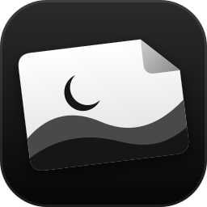
</p>

<h1 align="center">mypaper</h1>

<p align="center">
  <b>Make Windows yours, at almost no cost.</b><br>
  Live wallpapers of every kind, desktop widgets, a top bar and dock that can replace the taskbar,
  and native Windows styling. All of it sleeps the moment a game is in front.
</p>

<p align="center">
  <a href="#quick-start">Quick start</a> ·
  <a href="#whats-inside">What's inside</a> ·
  <a href="#performance">Performance</a> ·
  <a href="#make-your-own">Make your own</a> ·
  <a href="#documentation">Docs</a>
</p>

<p align="center">
  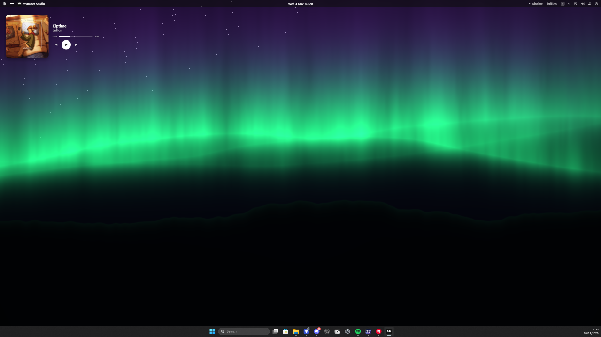
</p>

---

## Why mypaper

- **Every wallpaper kind.** Shaders, photos, slideshows, hardware-decoded video (including 10-bit HDR),
  3D glTF scenes, web pages, and external renderers such as a Unity build. One engine runs them all,
  behind your desktop icons.
- **Light, and kept light.** Hidden means zero: covered monitors, fullscreen games, a locked PC and
  battery all put mypaper to sleep at 0% CPU and GPU. While a game is in front, all of mypaper uses
  about 35 MB. [Performance](#performance) explains how this is measured and enforced.
- **Your desktop, your layout.** Interactive widgets snap to a grid that matches Windows' own icon
  grid. There's a macOS-style top bar and a dock that can stand in for the taskbar. All of it can be
  restyled, from no background at all to glass.
- **Safe by design.** No code is injected into other processes. Every change mypaper makes to Windows
  is journaled and undone on quit, on the panic hotkey, and after a crash.

## What's inside

### Wallpapers

<table>
  <tr>
    <td align="center">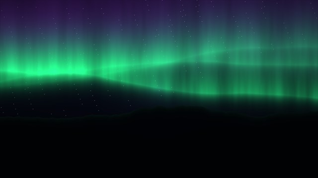<br><b>Aurora</b> · shader</td>
    <td align="center"><br><b>Midnight</b> · shader + Windows styling</td>
    <td align="center">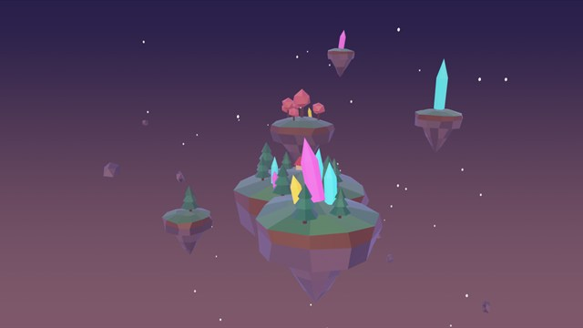<br><b>Islands</b> · 3D scene</td>
  </tr>
  <tr>
    <td align="center">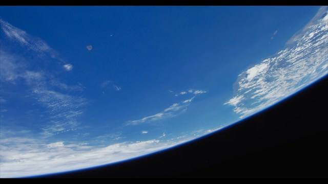<br><b>Earth orbit</b> · video</td>
    <td align="center">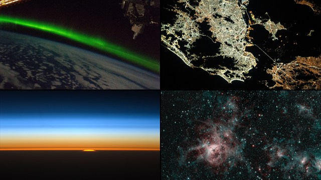<br><b>Gallery</b> · slideshow</td>
    <td align="center">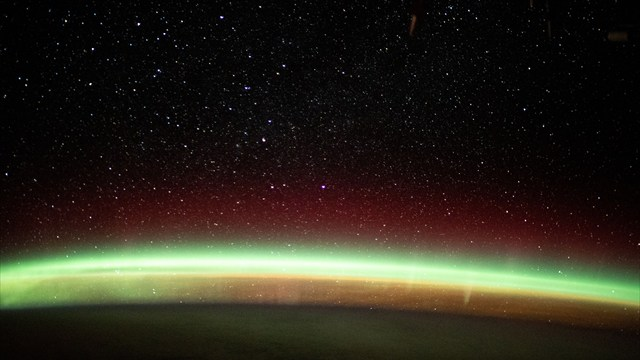<br><b>Photo</b> · image</td>
  </tr>
</table>

| Kind | What it is | How it stays light |
|---|---|---|
| `shader` | A WGSL fragment shader | fps cap; render scale (0.5 is a quarter of the pixels) |
| `image` | Any format WIC decodes, with EXIF rotation | decoded once at screen size, drawn once |
| `slideshow` | A folder, cross-faded | idle between slides; the next image is decoded ahead |
| `video` | H.264, HEVC, VP9 or AV1, in 8-bit or 10-bit HDR | hardware decode, zero-copy into the GPU, paused when hidden |
| `scene` | A glTF / GLB scene with orbit and parallax; optionally interactive (drag to orbit) | few draw calls; static scenes draw once |
| `web` | A local page or URL (WebView2); optionally interactive (mouse input over the bare desktop) | suspended while hidden; a still is shown on paused screens |
| `app` | Any renderer that takes a window handle (e.g. Unity's `-parentHWND`) | the process is suspended while hidden |

The bundled photos and video are public-domain NASA media ([credits](themes/CREDITS.md)).

### Widgets

28 widgets, each in its own sandbox:

- **Time**: clock (desk, flip or minimal), analog clock, world clock, calendar (month, agenda or
  week), countdown, timer.
- **Media**: now playing (card, art backdrop or strip), media pill, audio visualizer.
- **Web**: weather (animated scenes, hourly and 5-day), RSS, crypto.
- **System**: system monitor (rings, bars or sparklines), battery, network, disk, system info, quick
  toggles.
- **Tools and personal**: notes, todo, activity heatmap, launcher, app shortcuts, search, quote,
  greeting, photo, and photo frame.

**Five design styles** apply to every widget:
- **minimal**;
- **depth**: raised 3D cards;
- **neon**: glowing outlines;
- **paper**: matte;
- **aero**: glossy glass.

Each combines with a surface (none, glass or solid), a tint, blur, radius, text tone, accent, font
and scale.

**Edit mode** (**Ctrl+Alt+Shift+W**):
- drag to move and resize within each widget's own limits, snapping to the grid;
- add, duplicate and restyle any widget.

**Overlay widgets** (**Ctrl+Alt+Shift+O**) float above your apps.

Widgets keep running on any monitor you can see, and pause only where they're covered.

### Top bar, dock and menus

<table>
  <tr>
    <td align="center">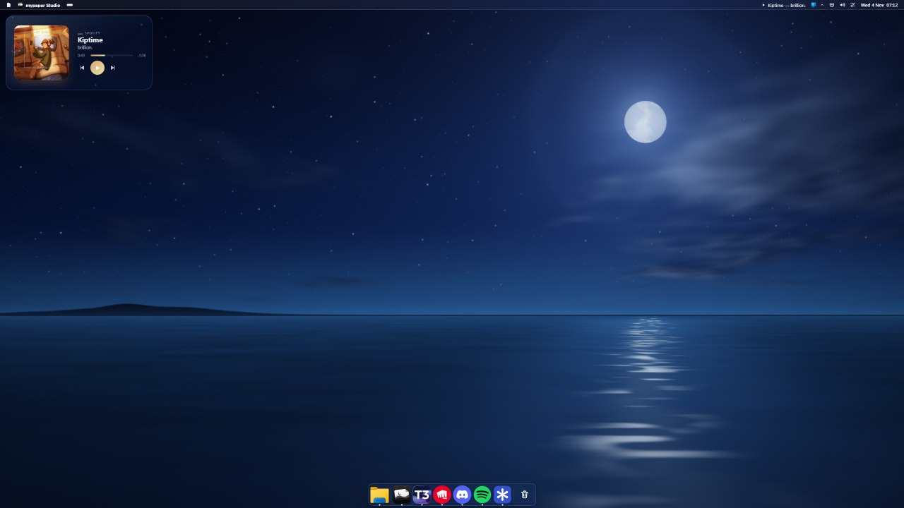<br><b>macOS</b> · top bar + centered dock</td>
    <td align="center">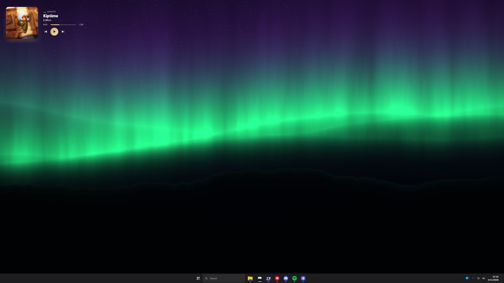<br><b>Windows 11</b> · full taskbar replacement</td>
  </tr>
  <tr>
    <td align="center">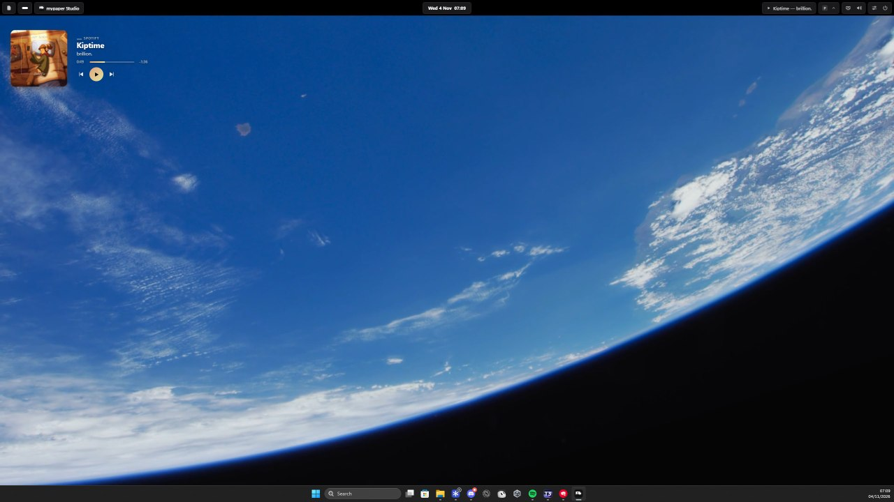<br><b>Islands</b> · one pill per group</td>
    <td align="center">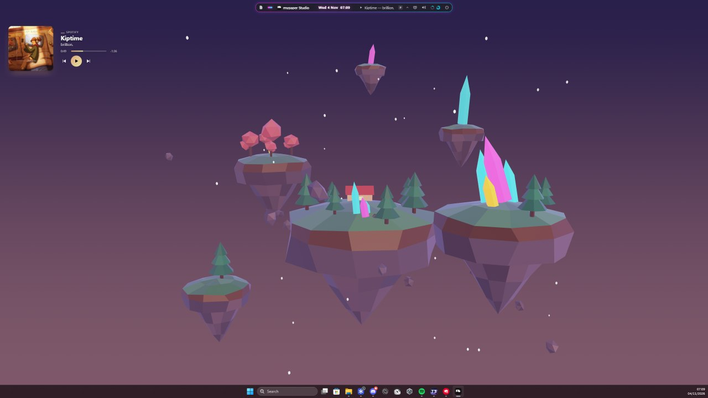<br><b>Neon glass</b> · floating, glowing edge</td>
  </tr>
</table>

Six presets: monochrome, macOS, Windows 11, islands, neon glass and floating.

**Everything about the bars is configurable:**
- **Layout:** floating, islands, full-width or strip; any screen edge; per-monitor overrides.
- **Backgrounds:** solid, gradient, image, or **wallpaper glass**, a blurred copy of your *live*
  wallpaper behind the bars.
- **Edges:** tint, grain, squircle corners, and border, glow and shadow for each state.
- **Motion:** named curves, custom cubic-béziers and springs.
- **Dock:** magnify with falloff, launch bounce, attention pulse, five indicator styles, and live
  window previews.
- **Modules:** click, middle-click, wheel and right-click actions, custom modules (any command, on
  an interval), and icon packs.

**Our own menus replace Windows':**
- a Start menu with four layouts (Windows 11, launchpad grid, a compact search bar, or a dashboard),
  optionally opened with the Win key;
- quick settings (brightness, radios, power mode);
- a Wi-Fi list, a per-app volume mixer, a language switcher and a calendar;
- notifications;
- a real **tray host** that shows your tray icons with no injection, the same approach ManagedShell
  uses.

The native taskbar can be kept, auto-hidden or hidden completely. It's always restored exactly.

### Windows styling

A theme can set:
- the accent color (or pick it from the wallpaper);
- window borders and title-bar colors;
- corners, Mica, acrylic and dark mode.

These apply only to Windows' own windows, never to games or other apps. See
[docs/windows-styling.md](docs/windows-styling.md).

### Desktop extras

- **Desktop right-click menu (opt-in):** our own themed menu on the bare desktop, opening in under
  10 ms. Right-clicking an icon, or pressing Shift, still gives the native menu.
- **Cursor themes:** two built-in sets, dark and light.
- **Desktop tray menu:** desktop icon size and visibility.
- **Classic Windows 11 context menu (opt-in):** a reversible toggle.

Every change is journaled and restored. See [docs/desktop-extras.md](docs/desktop-extras.md).

### Studio

<p align="center">
  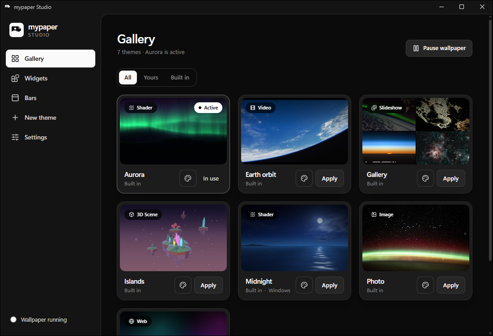
</p>

Studio has:
- a gallery;
- new themes from any image, video, folder, shader, 3D model, page or app;
- a styling editor with a live preview;
- bar and dock settings;
- the widget list.

## Performance

mypaper's promise: **if you can't see it, it costs nothing, and what you can see costs very little.**

Measured on a Ryzen laptop (AMD iGPU and NVIDIA dGPU, two 1440p monitors), release builds:

| What is on screen | CPU (whole machine) |
|---|---|
| Shader wallpaper at 60 fps | 0.17% |
| Image, or slideshow between slides | 0.01–0.02% |
| 1080p30 video | 0.23% |
| 3D scene at 30 fps | 0.12% |
| 7 widgets | 0.07% |
| Everything covered, or a game fullscreen | **0.00%**; all of mypaper in ~35 MB |

**At sign-in, your look comes first.**

| Step | Time |
|---|---|
| Your look on screen | at once: Windows itself shows a still of your theme before mypaper starts |
| Native taskbar hidden | ~23–60 ms after mypaper starts |
| Native stand-in for the bars | ~224 ms |
| Live wallpaper, first frame | ~1.1 s (a shader alone: ~0.75 s) |

**How it stays this way:**
- **Event-driven everywhere.** Nothing polls; every process sleeps on its message queue.
- **Wallpaper GPU work:** the low-power GPU, our own frame pacing, render scale, and zero-copy video.
- **Widgets and bars** share one WebView2 browser process. After 30 s paused, widget WebViews are
  released entirely.
- **Budgets enforced by a harness.** `mypaper-perf` runs 10 fixed scenarios against **102
  budgets** (startup, CPU, memory, cost while paused) in [`perf/budget.toml`](perf/budget.toml), and
  fails on any regression. See [docs/performance.md](docs/performance.md) and the
  [latest results](perf/latest.md).

## Quick start

You need Windows 10/11, [rustup](https://rustup.rs) and [pnpm](https://pnpm.io). The pinned
nightly toolchain installs itself.

```sh
cargo build --release --workspace          # core, wallpaper, widgets, bars, plugins
pnpm -C widgets/shell install && pnpm -C widgets/shell build
pnpm -C bars/shell install && pnpm -C bars/shell build
target/release/mypaper-core                # wallpaper + widgets + bars + tray icon

cd apps/studio && pnpm install && pnpm release   # mypaper Studio
```

| Shortcut | Does |
|---|---|
| **Ctrl+Alt+Shift+Backspace** | Panic: stop everything and restore the stock desktop and taskbar |
| **Ctrl+Alt+Shift+W** | Widget edit mode (also in the tray) |

Settings live in `%APPDATA%\mypaper\` (`config.json`, `widgets.json`, `bars.json`). Every process
watches them and applies changes live, and Studio and the tray just edit them. Logs go to
`%LOCALAPPDATA%\mypaper\mypaper.log`.

## Make your own

- **A theme** is a folder with a `theme.json`. It sets the wallpaper, plus optional Windows styling and
  looks for the widgets and bars (with your own CSS). See [Themes](#themes) below.
- **A widget** is a folder with `widget.json` and HTML/CSS/JS, using a small typed API. A mock host
  lets you build it in a browser: [docs/writing-widgets.md](docs/writing-widgets.md).
- **A plugin** is any executable, in any language, that speaks JSON-RPC over stdio and feeds data to
  widgets: [docs/writing-plugins.md](docs/writing-plugins.md).

### Themes

```json
{
  "name": "Midnight",
  "wallpaper": { "kind": "shader", "source": "midnight.wgsl", "fps": 30, "scale": 0.6 },
  "windows": { "accent": "auto", "corners": "round", "backdrop": "mica", "dark_mode": true },
  "widgets": { "appearance": { "surface": "glass", "tint": "#0c1830" }, "css": "widgets.css" },
  "bars":    { "appearance": { "surface": "glass", "tint": "#0c1830" }, "css": "bars.css" }
}
```

A shader wallpaper is one function. Everything else lives in
[`prelude.wgsl`](crates/wallpaper/src/prelude.wgsl):

```wgsl
fn wallpaper(frag: vec2f) -> vec4f {
    let uv = frag / paper.resolution;   // also paper.mouse, paper.time (stops while hidden), paper.frame
    return vec4f(uv, 0.5 + 0.5 * sin(paper.time), 1.0);
}
```

Saving a theme file reloads it live, in 25–70 ms. Errors print with line numbers, and the last good
version keeps running.

## Architecture

```text
mypaper-studio        Tauri app: gallery, themes, styling, widgets and bars settings
mypaper-core          supervisor · tray · panic hotkey · Windows styling + undo journal
  ├─ mypaper-wallpaper   wgpu: one GPU device, one surface per monitor, behind the icons
  ├─ mypaper-widgets     a transparent WebView2 layer per monitor, above the icons
  │     └─ plugins       separate processes, JSON-RPC over stdio
  └─ mypaper-bars        top bar and dock (app bars), native-taskbar control + journal
```

| Folder | What it owns |
|---|---|
| `crates/core` | Supervisor (the wallpaper is essential; widgets and bars are optional), tray, styling lifecycle |
| `crates/wallpaper` | The engine: sources, frame pacing, palette, live config |
| `crates/widgets`, `widgets/shell` | The widget host and its page ([docs/widgets.md](docs/widgets.md)) |
| `crates/bars`, `bars/shell` | The top bar and dock ([docs/bars.md](docs/bars.md)) |
| `crates/tweaks`, `crates/inject` | Windows styling with an undo journal; which windows may be styled |
| `crates/desktop`, `crates/config`, `crates/theme` | Win32 plumbing, settings, theme format |
| `packages/widget-sdk`, `widgets/`, `plugins/` | Widget SDK, the bundled widgets and plugins |
| `apps/studio` | mypaper Studio (Tauri v2 + React + Tailwind) |

Builds are fast: incremental Rust rebuilds take 1–3 s, thanks to nightly Cranelift, the parallel
frontend, rust-lld and a DX12-only wgpu ([engine notes](docs/engine-notes.md)).

## Documentation

| Doc | About |
|---|---|
| [widgets.md](docs/widgets.md) | The widget system: host, grid, edit mode, appearance, API, plugins |
| [writing-widgets.md](docs/writing-widgets.md) · [writing-plugins.md](docs/writing-plugins.md) | Tutorials |
| [bars.md](docs/bars.md) | Top bar, dock, menus, presets and taskbar |
| [performance.md](docs/performance.md) | The harness, the budgets, and before/after startup numbers |
| [windows-styling.md](docs/windows-styling.md) | Accent, borders, Mica, dark mode, and what is restored |
| [web-and-app-wallpapers.md](docs/web-and-app-wallpapers.md) | Web and external-renderer wallpapers |
| [desktop-extras.md](docs/desktop-extras.md) | Desktop right-click menu, cursor themes, classic menu, interactive wallpapers |
| [engine-notes.md](docs/engine-notes.md) | Memory findings, hot-patching status |
| [research/customization-landscape.md](docs/research/customization-landscape.md) | How Seelen UI, YASB, ManagedShell, Rainmeter and others do it, with sources |

## Roadmap

Done recently: bar presets and rich backgrounds, wallpaper glass, our own menus and tray host,
widgets v2, the performance harness and instant first paint at sign-in, and the logo.

Next:
- **Live notifications:** instant updates instead of a 15 s recount. This needs package identity
  (a sparse package).
- **Theme sharing:** import and export a whole look (wallpaper, bars, widgets, cursors) as one file.
- **Startup:** cut the wgpu adapter probe, about 350 ms of the wallpaper's start.

Not planned: restyling Explorer's own UI or other apps from the inside. That needs code injection,
which mypaper doesn't do.
