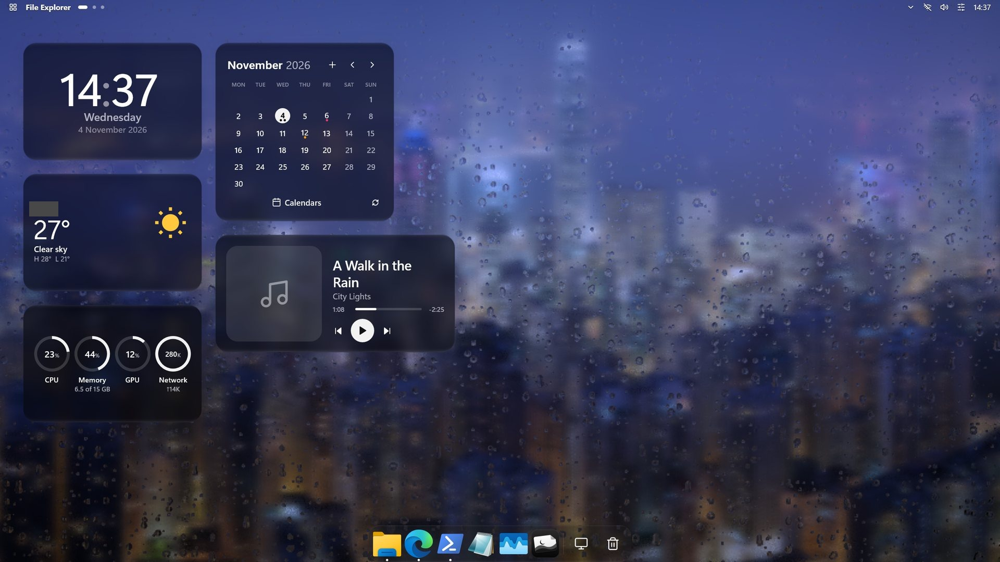
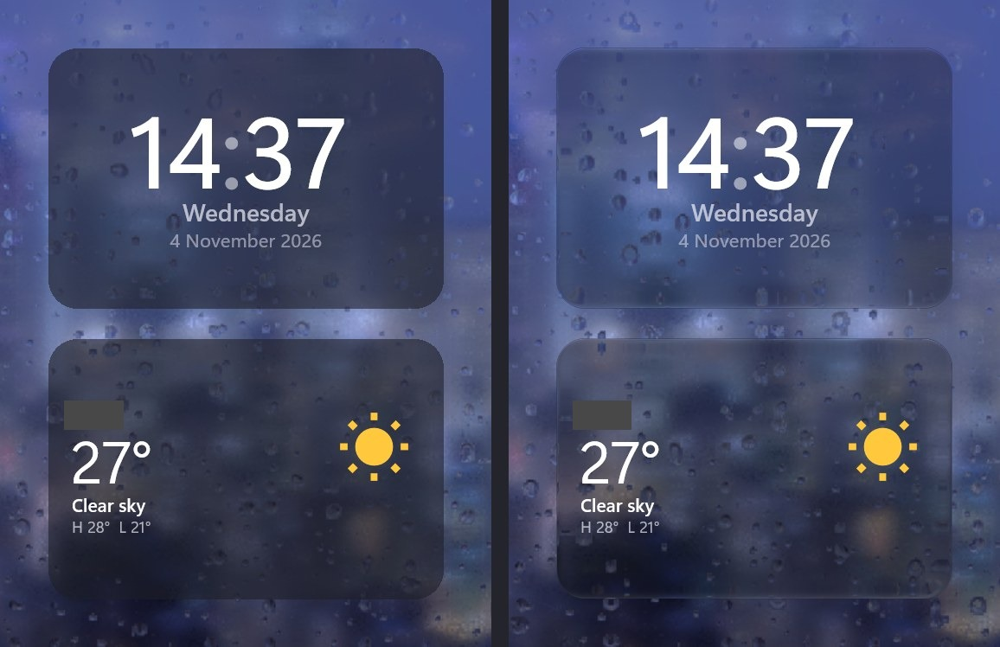
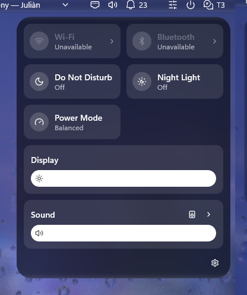
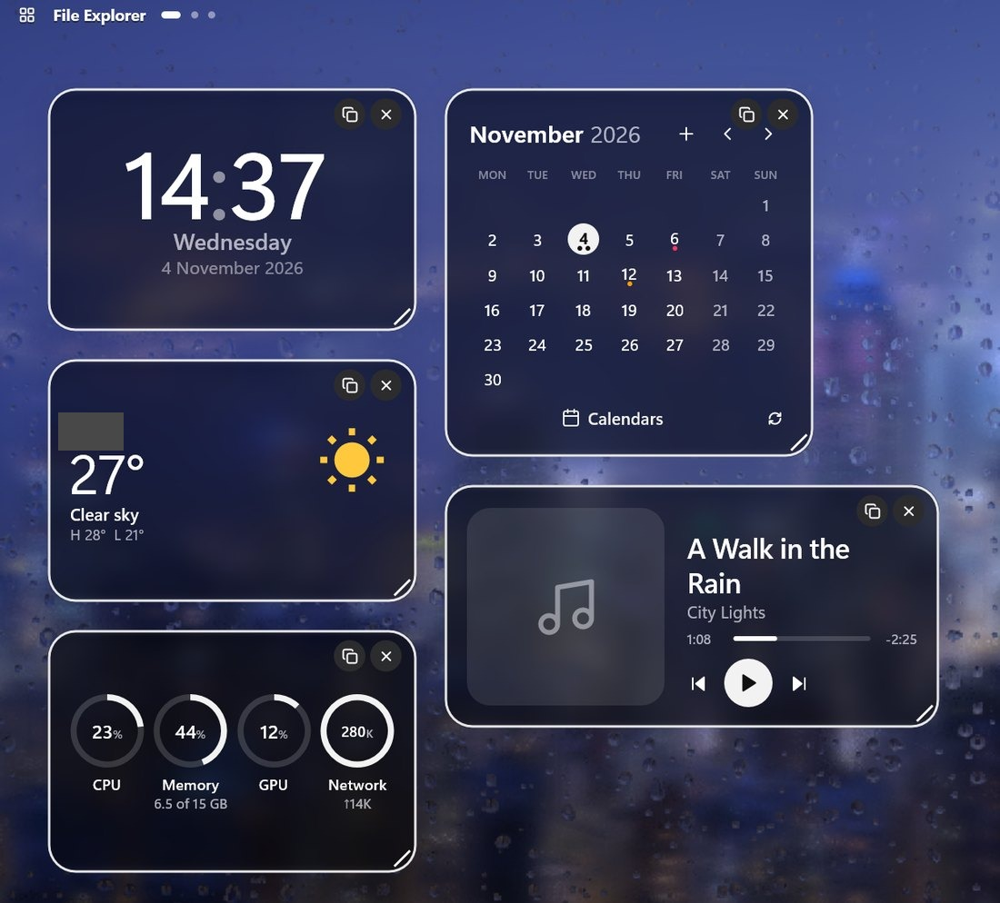
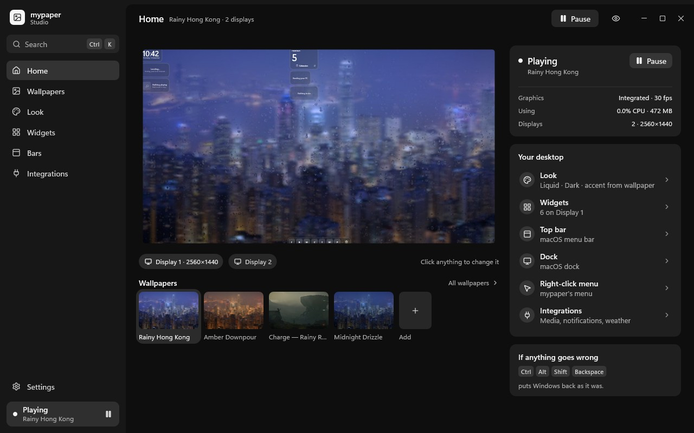

<p align="center">
  
</p>

<h1 align="center">Glaze</h1>

<p align="center">
  <b>A native Windows desktop, rebuilt in Rust: live wallpapers, Liquid Glass, a top bar and dock, and widgets, in a few MB.</b>
</p>

<p align="center">
  <a href="#whats-inside">What's inside</a> ·
  <a href="#performance">Performance</a> ·
  <a href="#architecture">Architecture</a> ·
  <a href="#install">Install</a> ·
  <a href="#make-your-own">Make your own</a> ·
  <a href="docs/README.md">Docs</a>
</p>

<p align="center">
  
</p>

- **Every wallpaper kind** on one wgpu engine: shaders, images, slideshows, hardware-decoded video,
  glTF scenes, web pages and external renderers.
- **Liquid Glass** on every surface, drawn by the engine with
  stillkit-glass ([liquid-rust](https://github.com/al1h3n/liquid-rust) in stillkit), always live to what's behind it.
- **Native shell** on software Direct2D: no WebView or hardware GPU device. Windows preferences and
  frame styling are journaled and undone on quit, on the panic hotkey and
  after a crash.

> Looking for the old WebView2 prototype? It's tagged [`v0.0.1`](https://github.com/Snowy7/glaze/releases/tag/v0.0.1).

## What's inside

### Wallpapers

One engine process (`glaze-wallpaper`) draws every screen behind the desktop icons.

| Kind | What it is |
|---|---|
| `shader` | A WGSL fragment shader, with an fps cap and render scale |
| `image` · `slideshow` | Any format WIC decodes, decoded once at screen size; folders cross-fade |
| `video` | Hardware decode, zero-copy into the GPU, paused when hidden |
| `scene` | A glTF / GLB scene with orbit and parallax |
| `web` · `app` | A page in WebView2, or any renderer that takes a window handle (e.g. Unity's `-parentHWND`) |

The bundled themes are curated, openly licensed works: rainy city windows, snow, a fireplace,
forests, the Milky Way, seascapes. Each keeps its own licence and credit in
[themes/CREDITS.md](themes/CREDITS.md). Hidden means zero: covered screens, fullscreen games and a
locked PC pause the engine. The GPU (`auto`, integrated or high-performance) and frame rate are
settings, per wallpaper too; `auto` renders on the card that drives your screens.

### Liquid Glass

<p align="center">
  <br>
  <sub>Left: a flat tint. Right: the engine's Liquid Glass, clarity set to clear.</sub>
</p>

The bars, dock, widgets, flyouts and menus all sit on glass that the engine draws with
**stillkit-glass** (liquid-rust): a squircle lens refracts the backdrop (Snell's law, η 1.5), with light frost, a
directional rim light and a soft shadow. Thin glass such as the 24 pt bar gets a shallow lens with a
flat face. Clarity (clear to tinted), blur, refraction, highlight and tint are adjustable per family
(bars, widgets, menus). Over app windows, menus, flyouts and covered bar surfaces use native DWM
backdrop frost, with captured engine glass as fallback. Native glass bars keep this backdrop over
wallpaper too, so movement never switches providers. Widgets also get live glass over `web` and `app` wallpapers, with capture released
when covered. See [docs/glass.md](docs/glass.md#glass-over-web-and-app-wallpapers-p14-6-november-2026).

### Top bar and dock

A native top bar and dock replace the taskbar (keep it, auto-hide it, or hide it; it's always
restored). Presets include macOS, Windows 11, Windows 10, ChromeOS, islands, floating, pill, edge
and neon glass. The dock groups windows by app, magnifies, and shows live window previews. A real
tray host shows your tray icons without injection. Bar modules include T3 Code, OBS, Docker and
Tailscale. See [docs/bars.md](docs/bars.md).

### Five styles

- **liquid**: Liquid Glass, the default.
- **oneui**: frosted.
- **fluent**: acrylic, 8 px corners.
- **solid** and **mono**: no glass.

The style applies to the bars, dock, flyouts, menus and widgets alike, in light and dark. The
same `look.style` switch synchronizes Windows frames, accent and light/dark mode, with independent
overrides. The `preset_style_grid` golden test renders every preset in every style. See
[Windows styling](docs/windows-styling.md#one-switch-for-the-desktop).

The **App styler** is a separate, off-by-default experiment (`experimental.app_styler`) for
Explorer's separate folder processes and Settings. Settings needs an explicit per-app opt-in;
known hangs and crashes keep this experimental. Presets, undo and current limits are in
[docs/windows-styling.md](docs/windows-styling.md#app-styler-experimental).

### Panels and menus



- **Control Center:** Wi-Fi, Bluetooth, do not disturb, night light, power mode, display and
  sound.
- **Notifications:** grouped per app, with the month below.
- **Launcher:** press Win and type to search apps, files and settings; pinned and recent apps,
  clipboard.
- **Desktop menu:** the full right-click menu, with each item's real icon.

Flyouts also cover Wi-Fi, a per-app volume mixer, the keyboard layout, power and the tray. Our
desktop menu replaces Windows' on the bare desktop, including Explorer's own verbs and the **New**
submenu; Shift or right-clicking an icon still gets the native one. See
[docs/desktop-extras.md](docs/desktop-extras.md).

<br clear="right">

### Files and search

An optional native **file index** searches names and paths and supplies cached folder sizes to
the launcher and Files. Enable `experimental.file_index`; `index.exclude` and `index.include`
refine its built-in build/cache exclusions. Incomplete sizes are labelled. See
[docs/index.md](docs/index.md).

**Glaze Files** is an on-demand native browser: tabs, previews, indexed search and queued file
operations. Launch it directly, or opt into folder routing with `experimental.files_default`;
Win+E routing uses the shell's existing Windows-key hook. See [docs/files.md](docs/files.md).

### Windows preferences and games

Optional, reversible system settings cover Game Mode, file extensions, hidden files, separate
Explorer folder processes and power mode. During games, background widgets, plugins and index
work pause; `engine.during_games` defaults to `"pause"` across all screens, or `"keep"` to animate
uncovered screens. `system.game_activity: false` disables the observer. See
[docs/system.md](docs/system.md#games).

### Widgets

17 built-in native widgets, each with a designed layout per size: clock, calendar, countdown, timer,
now playing, media pill, weather, RSS, crypto, system monitor, quick toggles, launcher, photos,
notes, to-do, activity heatmap and quote. They snap to a per-monitor grid on the desktop layer, or
float above apps as overlays.

<p align="center">
  <br>
  <sub><b>Edit mode</b> (Ctrl+Alt+Shift+W): drag and resize on the grid; <b>+</b> opens the widget picker.</sub>
</p>

**Integration widgets** run WebAssembly plugins in an on-demand helper and subscribe to local apps
only while visible:

- **T3 Code:** running threads, threads that need you (approve or deny), a new-thread prompt,
  **Usage** (30-day cost and tokens per provider) and **Limits** (each provider's windows and
  accounts, with pace and reset countdowns).
- **Discord**, **Docker**, **OBS**, **Tailscale** and **Grok Bot**.
- **Calendars:** read-only calendar sources shown in the calendar widget.
- **Custom widgets:** your own, from a JSON file ([below](#make-your-own)).

Settings for each live in Studio. See [docs/widgets.md](docs/widgets.md) and
[docs/integrations.md](docs/integrations.md).

### Studio

<p align="center">
  
</p>

Studio is the native settings app, on the same UI kit as the shell. It opens in about 250 ms, uses
13–25 MB while open and nothing once closed. Every page edits the same settings files the shell
watches, so changes show on the desktop at once, with undo and redo:

- **Home** and **Wallpapers:** pick and tune the wallpaper.
- **Look:** style, glass material, colours.
- **Widgets:** arrange on a live preview.
- **Bars** and **Integrations:** modules, dock, and each integration's settings.
 **Ctrl+K** finds any setting, wallpaper, widget or action. See
[docs/studio-ux.md](docs/studio-ux.md).

## Performance

Measured on the development machine: 16 logical CPUs, an AMD iGPU and an RTX 4070 SUPER, two
2560×1440 screens, release builds, 5 November 2026. CPU is percent of **one core**; memory is
private bytes.

| What | Measured | Gate |
|---|---:|---:|
| Shell (bars, dock, 6 widgets), idle, both screens visible | **32 MB**, median of 3 | ≤40 MB |
| Shell CPU over maximized apps | **0.05%** median | ≤0.05% |
| Shell CPU with six widgets visible | 0.18% median | ≤0.1% (open) |
| Core (supervisor, tray, journal) | **2 MB**, 0.00% | ≤8 MB |
| Engine, rain-city at 30 fps, two screens, 16 glass plates, iGPU | **257 MiB** (was 448) | ≤272.4 MiB |
| Engine on the RTX that drives the screens (one screen visible) | **180–198 MiB** | |
| GPU for all 16 glass plates together, iGPU | **0.275 ms** per frame, median | ≤0.3 ms |
| Liquid Glass per screen, 8-plate lab fixture | **0.08 ms** RTX 4070 SUPER · 2.48 ms AMD iGPU | ≤2 ms (iGPU open) |
| Steady processes · WebView2 processes | **3 · 0** | 3 · 0 |
| Studio, open · closed | 13–25 MB · no process | |

**How it's measured.** `tools/perf` (`glaze-perf --native`) takes the desktop lock, launches the
engine with a fixed plate fixture in isolated settings, and samples private bytes and process CPU
time: median of 3×60 s runs. `--timestamps` adds wgpu GPU timestamp queries per pass. The shell gates
use `measure.ps1 -Seconds 60` on the live desktop. Budgets live in
[perf/budget.toml](perf/budget.toml); the method, every before/after, and the gates still open are in
[docs/performance.md](docs/performance.md), [docs/bars.md](docs/bars.md) and
[docs/glass.md](docs/glass.md).

The [6 November live measurements](docs/performance.md#live-engine-hillclimb-6-november-2026)
also record the Studio-preview fix (about 26% → 3–4% of one core), releasing drawing resources
after 10 s covered, game quiescence, and the cost of glass over web wallpapers. These live runs
use a different fixture from the 5 November table above.

**Why it stays small:**
- **One hardware GPU device for the whole product.** A process with one pays about 240 MB for the
  driver stack, so only the engine has one. The shell and Studio draw with software Direct2D and
  DirectWrite into layered windows. A test checks that no vendor driver DLL loads into the shell.
- **If nothing changes, nothing is drawn.** Surfaces redraw only changed regions; timers run only
  while something moves; glass redraws only when the pixels behind it change.
- **Event-driven.** Every process sleeps on its message queue. Integrations subscribe only while a
  widget or panel shows them, and cancel when it closes.

## Architecture

```text
glaze-core         supervisor · tray · panic hotkey · Windows styling + undo journal
 ├─ glaze-wallpaper  the engine (wgpu): wallpapers, glass plates, glass overlays. The only GPU device.
 ├─ glaze-shell      software Direct2D: top bar, dock, flyouts, menus, launcher, widgets, tray host
 │    └─ glaze-plugins  on demand: WebAssembly integrations
 ├─ glaze-index      experimental, off by default: file names and folder sizes
 └─ glaze-styler     experimental, off by default: app interiors
glaze-files        native file browser; runs only while open
glaze-studio       the settings app (software Direct2D); runs only while open
```

| Rule | What it means |
|---|---|
| One GPU device | The engine draws the wallpaper **and all glass**. The shell publishes plate geometry; it never captures the desktop. |
| Nothing changes, nothing drawn | Display lists diff; only changed bounds redraw; still wallpaper and still plates cost 0 GPU. |
| Windows integration | Frame styling uses public APIs. The separate, opt-in App styler loads code into allowlisted apps; it stays experimental. |
| Journaled undo | Every change to Windows (taskbar, styling, menus) is journaled and replayed on quit, panic (**Ctrl+Alt+Shift+Backspace**) and crash. If the shell dies, core restores the taskbar and restarts it. |

| Crate | Owns |
|---|---|
| `crates/core` | Supervisor, tray, panic hotkey, styling lifecycle |
| `crates/wallpaper` | The engine: sources, frame pacing, glass passes, overlays |
| [stillkit](https://github.com/Snowy7/stillkit) | The UI library (as `glaze-ui`) and its Liquid Glass renderer, `stillkit-glass` |
| `crates/shell` | Bars, dock, flyouts, desktop menu, widget views, integrations views |
| `crates/widgets` · `crates/bars` · `crates/integrations` | Services: catalog, layout, storage, plugins; app bars and tray; integration providers |
| `crates/studio` | Glaze Studio |
| `crates/files` · `crates/index` | On-demand file browser; optional native name index and folder sizes |
| `crates/app-styler` | Experimental helper and XAML styling DLL for app interiors |
| `crates/fswatch` | Shared native directory notifications, with no idle polling |
| `crates/desktop` · `crates/config` · `crates/theme` · `crates/tweaks` · `crates/inject` | Win32 plumbing, settings, theme format, Windows styling with undo, which windows may be styled |
| `crates/glass-ipc` | Plate and overlay protocol between the shell and the engine |

More in [docs/ui.md](docs/ui.md) and the [native plan](plans/council/native-plan.md).

## Install

Download the latest `Glaze-*-windows-x64.zip` from [Releases](https://github.com/Snowy7/glaze/releases),
extract all of it and double-click `install.cmd` (not as administrator). It installs per user, and
uninstalling from Settings > Apps first undoes every change Glaze made to Windows. See
[docs/release.md](docs/release.md) for SmartScreen and signing.

## Build from source

You need Windows 10 or 11 and [rustup](https://rustup.rs); the pinned nightly toolchain installs
itself.

```powershell
cargo build --release --workspace
target\release\glaze-core.exe      # engine + shell + tray icon
target\release\glaze-studio.exe    # Studio (also: tray › Open Studio, or the desktop menu)
```

To swap a fresh build into a running desktop (build elsewhere, then deploy; Glaze is down only
for the copy):

```powershell
$env:CARGO_TARGET_DIR = "C:\glaze-targets\main"; cargo build --release --workspace
powershell -NoProfile -File scripts/deploy-local.ps1
```

| Shortcut | Does |
|---|---|
| **Ctrl+Alt+Shift+Backspace** | Panic: stop everything and restore the stock desktop and taskbar |
| **Ctrl+Alt+Shift+W** | Widget edit mode |
| **Win** | The launcher (optional) |

Settings live in `%APPDATA%\glaze\` (`config.json`, `widgets.json`, `bars.json`,
`integrations.json`). Every process watches them and applies changes live. Logs go to
`%LOCALAPPDATA%\glaze\glaze.log`.

Upgrading a local installation from the old `mypaper` name: stop its desktop and Studio,
then run `powershell -NoProfile -File scripts/migrate-local.ps1` before deploying Glaze.
The script backs up both AppData profiles under `%LOCALAPPDATA%\glaze-migration-backups`,
moves settings, themes and caches, updates saved app paths, and copies integration credentials
inside Windows Credential Manager. It refuses to overwrite an existing Glaze profile.
If startup was enabled, disable it with the old core's `--autostart off` and re-enable it with
`target\release\glaze-core.exe --autostart on` after deployment. Rebuild bundled components
with `scripts/build-plugins.ps1` when upgrading the plugin contract.

## Make your own

- **A custom widget** is one JSON file in `%APPDATA%\glaze\widgets\`. It shows up in the **+**
  picker and in Studio as a native widget, with a `stat`, `list`, `text`, `image` or `gauge`
  layout, fed by a static value, an HTTPS URL (with a JSON path), a file or a command. Its work runs
  only while it's visible:

  ```json
  {
    "title": "Rust release",
    "layout": "stat",
    "source": { "type": "url", "url": "https://api.github.com/repos/rust-lang/rust/releases/latest", "path": "$.tag_name" },
    "refreshSeconds": 3600,
    "size": [3, 2]
  }
  ```

  More examples: [crates/widgets/src/custom_examples](crates/widgets/src/custom_examples).
- **A plugin** is a WebAssembly component with native widget faces, running in the on-demand
  helper. The SDK, examples and lifecycle are in [docs/plugins.md](docs/plugins.md).
- **A theme** is a folder with a `theme.json` (wallpaper, plus optional Windows styling). A shader
  wallpaper is one WGSL function; the rest is in
  [prelude.wgsl](crates/wallpaper/src/prelude.wgsl). Saving reloads it live.
- **A built-in view** is Rust in `crates/shell/src/widgets/` on the kit ([docs/ui.md](docs/ui.md)).

## Roadmap

- **Plugin ecosystem.** More downloadable integrations on the [WebAssembly SDK](docs/plugins.md).
- **Studio redesign.** A refined canvas, search and focus, on the directions in
  [docs/studio-ux.md](docs/studio-ux.md).
- **Open performance gates:** shell CPU with widgets visible, Liquid Glass on integrated GPUs (2 ms
  per screen), and crash-to-bars recovery under 300 ms.
- **Experimental:** stabilize the App styler and bring the new native services into Studio.

## Credits and licences

- **[liquid-rust](https://github.com/al1h3n/liquid-rust)** by al1h3n, MIT OR Apache-2.0, carried in
  stillkit as [stillkit-glass](https://github.com/Snowy7/stillkit/tree/main/crates/stillkit-glass)
  with both licence texts and the few marked changes (`UPSTREAM-CHANGES.md`). Its look is calibrated against Apple's Liquid
  Glass kit.
- **Wallpapers:** each bundled theme's author, source and licence is in
  [themes/CREDITS.md](themes/CREDITS.md), with the source audit in
  [docs/research/wallpaper-sources.md](docs/research/wallpaper-sources.md). Some are
  **non-commercial** and marked so there.
- **Icons:** [Lucide](https://lucide.dev) outlines, ISC (licence in
  [THIRD-PARTY-NOTICES.md](THIRD-PARTY-NOTICES.md#icons-and-fonts)), and Windows' Segoe Fluent Icons
  for the Fluent style.
- **Everything else:** [THIRD-PARTY-NOTICES.md](THIRD-PARTY-NOTICES.md) summarizes every
  third-party licence. [THIRD-PARTY-NOTICES-crates.md](THIRD-PARTY-NOTICES-crates.md) has the full
  licence text of every Rust crate in the programs and bundled plugins.

Glaze itself is MIT licensed; see [LICENSE](LICENSE).

## Documentation

Every doc, with a line on each: [docs/README.md](docs/README.md).
