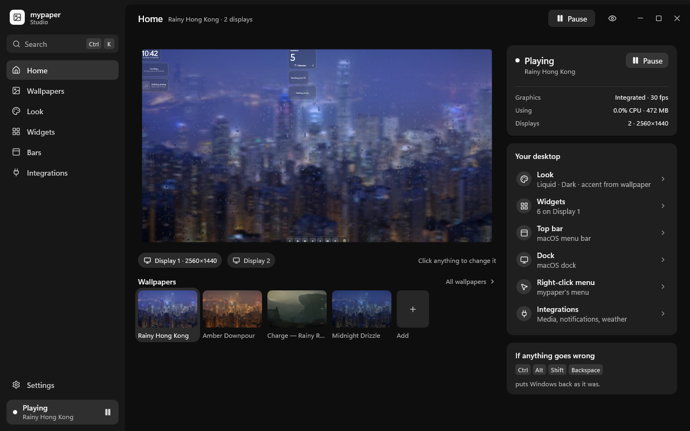

# Studio: the experience

How mypaper Studio is organized and why. Read this before adding a page or a setting. The rules at
the end ("Rules for new settings") are the short version. The design spec, with every feature's
place and the mockups, is [plans/native/studio-redesign.md](../plans/native/studio-redesign.md);
the screens below are the golden images in [media/studio](media/studio).

Studio is a native app (`crates/studio`, `mypaper-studio.exe`) on `crates/ui`: one window,
software Direct2D, no WebView and no GPU device. It edits the same files the rest of mypaper
watches (`config.json`, `bars.json`, `widgets.json`, `integrations.json`, and your own wallpaper
folders), so every change shows on the desktop at once. Closing it ends the process: nothing of
Studio keeps running.



## 1. The places

| Place | Keys | Question | Contents |
|---|---|---|---|
| **Home** | Ctrl 1 | "What's on my desktop, and is it OK?" | The live desktop (click anything to edit it), the wallpapers strip, status, Your desktop (a row per thing, one click from its editor) |
| **Wallpapers** | Ctrl 2 | "What's behind everything?" | The library by category, Add wallpaper, a wallpaper's inspector: Use, on the screen, mouse, performance, its look, credit |
| **Look** | Ctrl 3 | "How does it all look?" | **Desktop** tab: style, material, appearance, accent; More: text and icons, shape, different for bars, widgets or menus. **Windows** tab: presets, accent, apps, corners, material, pointer; More: edges, title bars |
| **Widgets** | Ctrl 4 | "What's on my desktop?" | The canvas, Add widget, a widget's options, size and own look, Always on top |
| **Bars** | Ctrl 5 | "My top bar and dock." | The stage, presets, a bar, a module, panels, the Windows taskbar |
| **Integrations** | Ctrl 6 | "What does it connect to?" | Connected, Built in, Available; the selected one's details |
| **Settings** | Ctrl , | "How does mypaper behave?" | General, Performance and power, Desktop, Keyboard, Troubleshoot, About |

The UI says **wallpaper**, never "theme" (D1): a wallpaper is a folder that can also bring a look.

**First run.** On a fresh install (no settings files yet) Studio opens onboarding full screen in
its own One UI, dark: a near-black page, large rounded cards, pill buttons. Every display fades to
black (`onboarding.rs`: plain layered "curtain" windows) and the welcome builds itself on the main
one: the mark, the words, three feature tiles wiping in, then Get started. The steps follow, words
on the left and choices on the right like Windows' own setup: **Your taskbar** (mypaper's bars,
keep Windows', or just the wallpaper), then optional **Pick a look**, **Your top bar** and **Your
dock** (designs, or off), **Choose a wallpaper** and **Extras** (file index, mypaper Files, the
desktop menu, full Explorer menus, file extensions, hidden files, Game Mode), and **You're all
set**. Steps that don't apply to the taskbar choice are skipped. Only the taskbar applies on
Continue; nothing else changes unless picked, and starters never change the wallpaper. Picks apply
at once and undo; Back never edits; **Skip setup** and Esc keep what's set. At the end the main
display fades out, Studio becomes its normal window and the displays fade back in. Only the intro
animates, so onboarding costs nothing while you read. `mypaper-studio --onboarding` shows it
again on a set-up PC. The docked panel shows the same steps with its own footer. Code:
`panel/first_run.rs`, `onboarding.rs`.

## 2. Navigation

- **Sidebar:** the mark, a search field that opens the palette, the six places, then Settings, then
  the **status block** (what's playing, Pause). It turns into a warning row when a part of mypaper
  has stopped ("Shell stopped · Restart").
- **Page bar:** the title, one line of context, the save state, Undo and Redo, **Peek**, the
  page's main action, and the caption buttons. Studio draws its own title area; Windows' snap
  layouts work through `WM_NCHITTEST` (`crates/ui/src/app_window.rs`).
- **Inside a page: selection, not tabs.** The inspector shows what's selected, with a back link to
  its parent ("‹ Bars"). Esc goes up one level. Look's Desktop | Windows switch and the Settings
  sections are the only second-level navigation.
- **Palette (Ctrl K):** one field over every setting, action, wallpaper, widget, integration and
  place (`search.rs`). Enter goes there: the page opens, the owner is selected, the **More** around
  the setting opens, and the row scrolls into view and flashes once. Space flips a switch right in
  the list.

## 3. One page shape: stage + inspector

```
┌ page bar: title · context        saved ✓  ↶ ↷  Peek  action  – □ × ┐
├────────────────────────────────────────────┬─────────────────────────┤
│                                            │ Inspector               │
│   Stage: the real thing, live              │  header (‹ back, reset) │
│   (click to select, drag to move)          │  presets                │
│                                            │  the common few         │
│   display chips                            │  ▸ More                 │
└────────────────────────────────────────────┴─────────────────────────┘
```

- **Stage.** Your wallpaper with the bars and widgets drawn by the shell's own code at their real
  geometry (section 5). Hover outlines what can be picked; click picks; a click on empty space
  goes back to the page's default selection. Widgets drag on the real grid and snap to cells; a
  drop that would overlap is refused. With several displays, chips under the stage switch them.
- **Inspector.** Header, then **presets** as visual tiles, then the **common few** settings, then
  **More** (closed by default, grouped). A setting that doesn't apply in the current mode is not
  drawn. A label, a control, at most one short line.
- **Layers, from the bottom:** the style, the wallpaper's look, your look, then a bar's or a
  widget's own. Your choice always wins. A value from below shows a quiet chip ("From Rain City",
  "Default"); touching it makes it yours, and ↺ on the row hands it back.
- **Click selects, Use applies** (D4): a wallpaper card only selects; the inspector's **Use**
  puts it on screen.

## 4. Saving, undo and outside edits

Every change is written as you make it, through one document store (`docs.rs`):

- Each file is re-read before a write and written atomically (temp file, then rename), so an edit
  made elsewhere a moment ago is kept. Studio watches the folder (`watch.rs`) and redraws when a
  file changes outside it.
- A file that can't be read is **never written**. Its pages show a banner with the reason and
  **Start over**, which keeps a backup first.
- A change is validated by the parser that owns the file (`mypaper_config`, `mypaper_bars`, the
  widget host's, the integrations') before it is written; an invalid one is refused, not saved.
- Undo and redo are app-wide steps. A slider drag or a widget move is one step however long it
  lasts. Applying a wallpaper toasts "Using Aurora · Undo".
- Edits inside your own wallpaper folders (fit, mouse, a program's arguments, a wallpaper's look)
  go straight to its `theme.json`, validated the same way. They are not undo steps. Built-in
  wallpapers are read-only: **Duplicate** makes an editable copy in place.
- Studio's own state (window placement, last page, recent wallpapers, first run, its light or
  dark) is `%APPDATA%\mypaper\studio.json`, outside the undo history.

## 5. Previews (D3)

- **Bars and widgets** are drawn by the shell's own views, linked as a library
  (`mypaper_shell::preview`), from the files being edited. A preview can't drift from the desktop
  because it is the same code. The stage runs it at the monitor's real geometry; where bars would be
  too small to read, the Bars page draws a narrower screen at the real bar size instead.
- **Glass** is drawn by the running engine over the real wallpaper, through a small shared-memory
  protocol (`crates/wallpaper/src/preview.rs`; `glass.rs` on Studio's side). The engine serves it
  only while Studio is asking, so it costs nothing when Studio is closed. Without an engine that
  answers, previews draw a flat stand-in tint and say "Glass shows when mypaper is running".
- **Wallpapers** show their preview picture (video: the shell's thumbnail), decoded off the UI
  thread into a 20 MB cache (`images.rs`).
- **Peek (Ctrl D)** hides Studio until the next key or click, to check the real desktop.

## 6. Look, and Windows styling as part of it (D2)

Your look is `config.json` › `look` (`crates/config/src/look.rs`). The **Desktop** half (style,
material, appearance, accent, text, shape, and per-family overrides) is projected by Studio onto
the keys the bars and widgets read (`bars.json` › `look`/`appearance`, `widgets.json` ›
`appearance`), only for the paths you touched (`look.rs`). The **Windows** half,
`look.windows`, is the layer over the wallpaper's own `windows` section, which is now a suggestion:
each field is absent (follow the wallpaper), `null` ("As is": leave Windows' own setting), or a
value. Core applies the result (`crates/core/src/styling.rs`). Styling Windows no longer needs a
copy of a built-in wallpaper. When Studio starts and your look has no Windows layer yet, it moves
the `windows` section of your own active wallpaper into your look
(`mypaper_theme::migrate_windows`), so nothing on screen changes.

## 7. Keyboard and accessibility

| Keys | Does |
|---|---|
| Ctrl K | Palette |
| Ctrl 1 – 6, Ctrl , | Home, Wallpapers, Look, Widgets, Bars, Integrations; Settings |
| Ctrl Z, Ctrl Shift Z / Ctrl Y | Undo, redo (outside text fields) |
| Ctrl D | Peek |
| Ctrl F | The page's search (Wallpapers, Integrations, Add widget) |
| F6 / Shift F6 | Next or previous region: sidebar, page bar, stage, inspector |
| Tab / Shift Tab | Next or previous control |
| Arrows | Inside groups: segmented controls, tiles, lists, the wallpaper grid, the sidebar; sliders step |
| Home / End | A slider's ends |
| Enter / Space | Activate; Space flips a switch |
| Esc | Leave a field, close an overlay, then go up one level |
| Alt ↑ / Alt ↓ | Move the focused row in a sortable list (modules, pinned apps, menu items) |
| Canvas: arrows / Shift arrows | Move the selected widget a cell / resize it |
| Delete | Remove the selected widget or module (undoable) |
| Ctrl Shift D | Duplicate the selected widget |

Focus reaches controls scrolled out of view (the inspector scrolls to them). Every stage action is
also in the inspector or a list, so nothing needs a pointer. AccessKit exposes every control from
its hit (role, label, state); the adapter loads on the first screen-reader request. Studio follows
Windows' light or dark (or Settings › Appearance), text size and contrast themes (tokens map to
system colors). Nothing animates, and state is never shown by color alone.

## 8. Cost

Measured on the development laptop, release build, 2026-11-05:

| | |
|---|---|
| Open (window shown and drawn, from process creation: `READY component=studio open_ms`) | 238–320 ms over five runs, median 247 ms; about 70 ms of it is Windows creating the first window |
| Memory, each place opened with its pictures loaded | 13–25 MB private, 33–49 MB working set, peak 52.6 MB (Home) |
| CPU while open and idle | 0% (it sleeps on its message queue; a toast or a live status line is the only timer) |
| Closed | no process; the engine serves previews only while Studio asks |

UI Automation loads on the first screen-reader request, not before the first paint. Text layouts
are cached for the few hundred labels on screen (`Text::set_capacity`).

## 9. Code map

| File | What |
|---|---|
| `main.rs` | Single instance, the window, the message loop, placement |
| `app.rs` | State, events, keyboard, focus, text fields, applying edits |
| `actions.rs` | Every `Action` a control can run, and the ids of settings and fields |
| `view.rs`, `ui.rs` | The frame (sidebar, page bar, regions, toasts, sheets) and inspector building blocks |
| `pages/*.rs` | One file per place, plus first run: its view, its actions, its keys |
| `settings.rs` | The settings index: every setting, its control, its place, its search words |
| `search.rs` | The palette |
| `docs.rs`, `watch.rs` | The document store (section 4) and the folder watcher |
| `look.rs` | Projecting your look onto the bars' and widgets' files |
| `library.rs` | Wallpapers: scanning, credits, editing your own, Add wallpaper, duplicate, recycle |
| `stage.rs`, `glass.rs`, `images.rs` | Previews (section 5) |
| `system.rs` | The parts of mypaper: status, start/stop/restart, autostart, diagnostics |
| `theme.rs` | Studio's own palette and type, from Windows' settings |
| `peek.rs`, `menu.rs`, `dialogs.rs` | Peek, native popup menus, the file picker |
| `goldens.rs` | Golden images of every main screen, light and dark |

Golden images: `cargo test -p mypaper-studio` compares every main screen with
`crates/studio/tests/golden`; `MYPAPER_BLESS=1` writes them anew, and the copies in
`docs/media/studio`.

## Rules for new settings

1. Put it where the thing is on screen. If it changes something visible, the stage must show it.
2. Common few up front, the rest under More. If it only applies in one mode, draw it only then.
3. One label, one control, at most one short line. No internals, no file names, no keyboard
   instructions; "As is" for leaving Windows' own setting alone.
4. Use the building blocks in `ui.rs` and `crates/ui/src/controls.rs`, never a one-off control.
5. Add it to `SETTINGS` in `settings.rs`, so the palette finds it and deep links reach it.
6. Write through `App::set` / `App::apply` (the document store), so it is validated and undoable.
